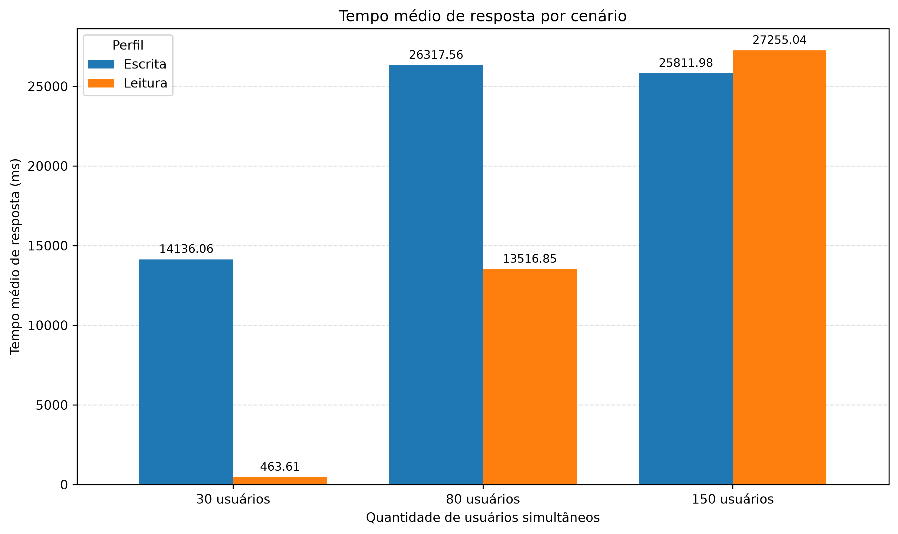
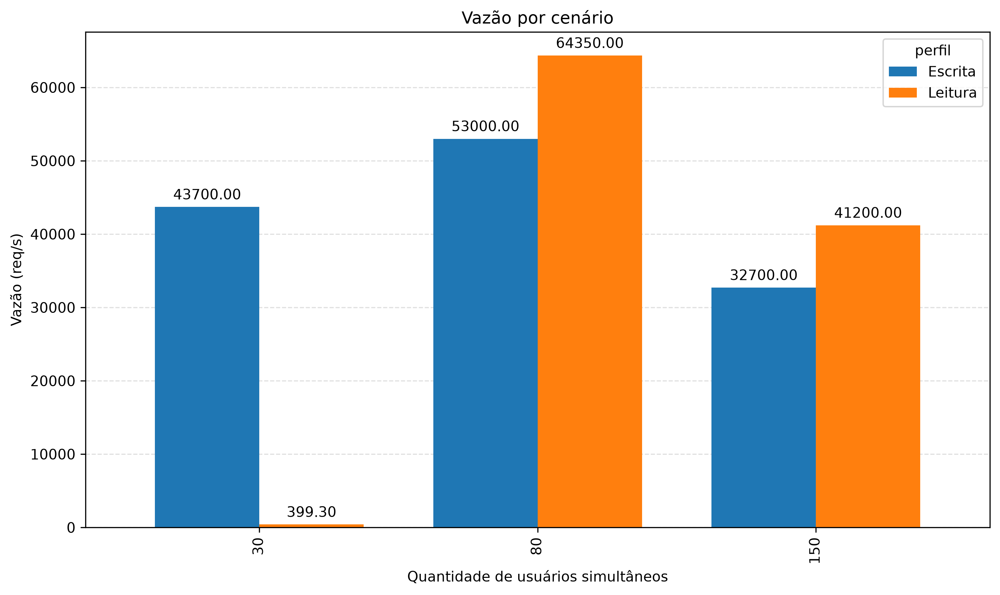
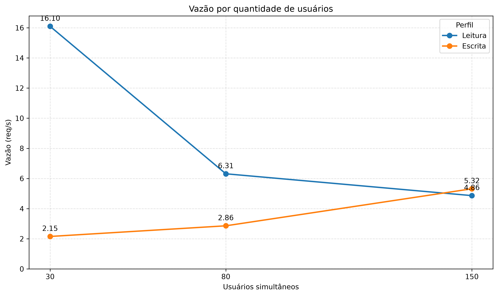
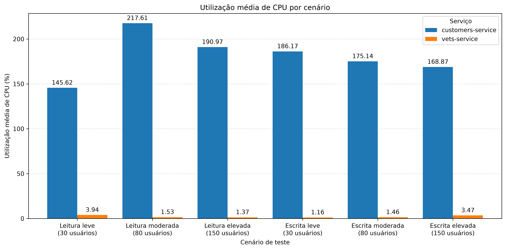

# Trabalho 06 - Sistema Distribuido
Avaliação de Desempenho de Microsserviços com Locust

## Objetivo

O objetivo é avaliar o desempenho da aplicação Spring PetClinic Microservices por meio de testes de carga utilizando o Locust, analisando como o aumento do número de usuários simultâneos e a variação entre operações de leitura e escrita influenciam o comportamento da aplicação. Durante os testes, serão coletadas métricas como tempo médio de resposta, percentil 95 (P95), vazão, total de requisições, taxa de falhas e utilização de CPU de dois serviços.


## Instruções de reprodução

### Pré-requisitos

Antes de iniciar, verifique se os seguintes recursos estão instalados na máquina:

- **Git:** para clonar o repositório do Spring PetClinic Microservices.
- **Docker:** para executar os serviços em contêineres.
- **Python:** para executar os scripts de teste e análise de desempenho.

### 1. Clonar o projeto Spring PetClinic Microservices

Clone o repositório oficial da aplicação:

```bash
git clone https://github.com/spring-petclinic/spring-petclinic-microservices.git
```

Em seguida, acesse a pasta do projeto:

```bash
cd spring-petclinic-microservices
```

### 2. Iniciar a aplicação com Docker

Na pasta raiz do repositório clonado, execute os serviços necessários:

```bash
docker compose up -d customers-service vets-service
```

Esse comando constrói as imagens necessárias. Aguarde a inicialização dos serviços antes de prosseguir 


Para acompanhar os logs de inicialização, execute:

```bash
docker compose logs -f
```

Pressione `Ctrl + C` para encerrar a exibição dos logs. Isso não encerra os contêineres.

### 3. Retornar à pasta do projeto de testes

Após iniciar a aplicação, retorne à pasta que contém os scripts de teste:

```bash
cd ..
```

### 4. Instalar o Locust

Instale o Locust com o comando:

```bash
python -m pip install locust
```

Verifique se a instalação foi concluída:

```bash
python -m locust --version
```

### 5. Executar os testes

Na raiz do projeto de testes, execute:

```bash
bash run_tests.sh
```
O script automatiza a execução dos cenários de teste definidos no projeto, coletando os resultados para posterior análise de desempenho.

## Descrição do ambiente

O ambiente experimental utiliza a aplicação Spring PetClinic Microservices, executada em contêineres Docker por meio do Docker Compose. Para a realização dos testes de desempenho, são utilizados os serviços `customers-service` e `vets-service`. O Locust é utilizada para simular acessos simultâneos à aplicação, permitindo executar diferentes perfis de carga e coletar métricas de desempenho. Os testes são automatizados por meio de um script Bash. Os testes são executados com 30, 80 e 150 usuários simultâneos, considerando os perfis de leitura e escrita. As métricas coletadas permitem analisar o comportamento da aplicação sob diferentes níveis de carga.

O ambiente contempla as seguintes ferramentas:

- **Spring PetClinic Microservices:** aplicação submetida aos testes.
- **Docker e Docker Compose:** execução e gerenciamento dos contêineres.
- **Locust:** simulação de usuários e coleta de métricas das requisições.
- **Python:** processamento dos resultados e geração dos gráficos.
- **Docker Stats:** monitoramento do consumo de CPU dos serviços selecionados.

## Metodologia

Os testes de carga com o Locust, foi considerando dois perfis: leitura e escrita. Cada perfil combina diferentes proporções de requisições HTTP para representar padrões distintos de acesso à aplicação.

No perfil de leitura, são utilizadas as operações `GET /owners`, `GET /owners/{id}`, `GET /vets` e `POST /owners`, com pesos de 45%, 35%, 15% e 5%, respectivamente. No perfil de escrita, os pesos são de 20% para cada uma das três operações GET e 40% para a operação `POST /owners`.

Os experimentos são organizados em três níveis de carga:

| Cenário | Usuários simultâneos | Duração | Aquecimento |
|---|---:|---:|---:|
| Leve | 30 | 6 minutos | 1 minuto |
| Moderado | 80 | 6 minutos | 1 minuto |
| Elevado | 150 | 6 minutos | 1 minuto |

Cada combinação entre perfil e quantidade de usuários é executada dez vezes, totalizando 60 execuções. O primeiro minuto de cada execução corresponde ao aquecimento e é descartado da análise, de modo que sejam considerados os cinco minutos restantes de medição.

Durante os experimentos, são coletadas as seguintes métricas:

- **Tempo médio de resposta (ms):** mede o tempo médio necessário para atender às requisições.
- **Tempo de resposta P95 (ms):** representa o percentil 95 dos tempos de resposta.
- **Vazão (req/s):** indica a quantidade de requisições processadas por segundo.
- **Total de requisições:** contabiliza as requisições realizadas durante o período de medição.
- **Taxa de falhas (%):** representa a proporção de requisições que falharam.
- **Utilização de CPU:** monitora o consumo de processamento de pelo menos dois serviços durante os testes.

Após as execuções, os resultados são organizados por perfil, quantidade de usuários e repetição. Para cada cenário, são calculadas as médias das métricas obtidas nas dez repetições. Por fim, foram gerados gráficos analisar o impacto do aumento da carga e das diferenças entre os perfis de leitura e escrita sobre o desempenho da aplicação.

## Análise dos Resultados

### 1. Tempo médio de resposta

No perfil de leitura, o tempo médio de resposta aumentou de 463,61 ms, com 30 usuários, para 13.516,85 ms, com 80 usuários, e 27.255,04 ms, com 150 usuários, indicando uma piora no desempenho com o aumento da carga. No perfil de escrita, os tempos foram de 14.136,06 ms, 26.317,56 ms e 25.811,98 ms para 30, 80 e 150 usuários, respectivamente, permanecendo acima de 25 segundos nos dois últimos cenários. Essa diferença entre os perfis pode estar relacionada à frequência de cadastros: o `POST /owners` representa 40% das requisições na escrita, contra 5% na leitura, e pode exigir processamento adicional para persistir os dados. Além disso, a pequena redução do tempo médio na escrita elevada não significa necessariamente uma melhora, pois esse cenário apresentou uma taxa de falhas maior. 



### 2. Percentil 95 (P95)

No perfil de leitura, o P95 foi de 399,3 ms para 30 usuários, aumentou para 64.350 ms com 80 usuários e chegou a 41.200 ms com 150 usuários, sendo o maior valor registrado no cenário moderado. No perfil de escrita, os valores foram de 43.700 ms, 53.000 ms e 32.700 ms para 30, 80 e 150 usuários, respectivamente. Apesar da redução no cenário elevado, os valores continuaram altos, indicando problemas nas respostas mais lentas. Na leitura moderada, por exemplo, o P95 chegou a 64,35 segundos, enquanto o tempo médio foi de aproximadamente 13,52 segundos, mostrando que algumas requisições demoraram muito mais que a média. Essa diferença pode estar relacionada à lentidão no processamento, a tempos de espera ou a timeouts.



### 5. Vazão

A vazão representa a quantidade de requisições processadas por segundo. No perfil de leitura, diminuiu de **16,10 req/s**, com 30 usuários, para **6,31 req/s**, com 80 usuários, e **5,38 req/s**, com 150 usuários. Já no perfil de escrita, aumentou de **2,15 req/s** para **2,86 req/s** e **4,68 req/s**, respectivamente. A queda na leitura indica redução da vazão com o aumento da carga, enquanto o aumento na escrita não representa necessariamente uma melhora, pois os cenários moderado e elevado apresentaram altas taxas de falhas.



### 3. Taxa de falhas

No perfil de leitura, a taxa de falhas foi de 0,0683% no cenário leve, com 33 falhas em 48.286 requisições, e 0,0422% no moderado, com 8 falhas em 18.936 requisições, mas subiu para 52,2958% no cenário elevado, com 7.631 falhas em 14.592 requisições. No perfil de escrita, a taxa passou de 1,0834% no cenário leve, com 70 falhas em 6.461 requisições, para 57,1079% no moderado, com 4.901 falhas em 8.582 requisições, e 77,5431% no elevado, com 12.372 falhas em 15.955 requisições. Esses resultados mostram que a aplicação apresentou poucas falhas sob carga leve e moderada de leitura, mas teve dificuldades nos cenários de maior carga, especialmente na escrita elevada. A maior participação da operação `POST /owners`, que representa 40% dos pesos das tarefas no perfil de escrita, pode contribuir para esse comportamento, embora os dados agregados não permitam atribuir as falhas exclusivamente a essa operação.


### 4. Utilização média de CPU

A utilização média de CPU foi maior no `customers-service` em todos os cenários, com destaque para a leitura moderada (217,61%) e a leitura elevada (190,97%). Nos demais cenários, os valores foram de 186,17% na escrita leve, 175,14% na escrita moderada e 168,87% na escrita elevada. Já o `vets-service` apresentou médias bem menores, variando entre 1,16% e 3,94%. Essa diferença indica que o processamento ficou mais concentrado no serviço de clientes, responsável pelas operações de consulta e cadastro de clientes, enquanto as consultas de veterinários são direcionadas ao serviço de veterinários.



## 4. Análise dos resultados

#### 1\. Como o aumento de usuários afeta o tempo de resposta?

O aumento de usuários provocou uma piora no tempo médio de resposta, principalmente no perfil de leitura, que passou de 463,61 ms, com 30 usuários, para 27.255,04 ms, com 150 usuários. No perfil de escrita, os tempos também aumentaram, passando de 14.136,06 ms para mais de 25 segundos nos cenários moderado e elevado. Isso indica que a aplicação teve dificuldades para manter respostas rápidas com o aumento da carga.

#### 2\. Qual perfil apresenta maior vazão?

O perfil de leitura apresentou maior vazão nos cenários leve e moderado, com 16,10 req/s e 6,31 req/s, respectivamente. No cenário elevado, a leitura registrou 5,38 req/s, enquanto a escrita alcançou 4,68 req/s. Portanto, a leitura apresentou maior vazão em todos os níveis de carga, embora sua vazão tenha diminuído com o aumento do número de usuários.

#### 3\. Quais operações apresentam maior degradação?

Os resultados agregados indicam maior degradação nos cenários de escrita moderada e elevada, nos quais o tempo médio de resposta ultrapassou 25 segundos e as taxas de falhas foram de 57,1079% e 77,5431%, respectivamente. A operação `POST /owners`, responsável pelo cadastro de clientes, pode contribuir para esse comportamento, pois representa 40% das tarefas no perfil de escrita. Entretanto, para identificar quais operações apresentam maior degradação individualmente, é necessário analisar os tempos de resposta e as falhas de cada endpoint separadamente.

#### 4\. Como o consumo de CPU varia entre os cenários?

O `customers-service` apresentou utilização média de CPU superior à do `vets-service` em todos os cenários, variando de 168,87% a 217,61%. Seu maior consumo ocorreu na leitura moderada, com 217,61%. Já o `vets-service` apresentou valores entre 1,16% e 3,94%. Essa diferença indica maior concentração do processamento no serviço de clientes, mas os dados de CPU, isoladamente, não permitem determinar a causa dos problemas de desempenho.

####  5\. Qual cenário apresenta maior taxa de falhas?

O cenário de escrita elevada, com 150 usuários, apresentou a maior taxa de falhas, de 77,5431%, correspondendo a 12.372 falhas em 15.955 requisições. Em seguida, destaca-se a escrita moderada, com 57,1079% de falhas, e a leitura elevada, com 52,2958%. Esses resultados mostram que a aplicação teve dificuldades para processar as requisições sob cargas mais altas, especialmente no perfil de escrita.

## Conclusões

Os testes realizados com o Locust demonstraram que o aumento da carga afetou o desempenho da aplicação Spring PetClinic Microservices, principalmente pelo aumento do tempo de resposta e da taxa de falhas. O perfil de leitura apresentou maior vazão em todos os níveis de carga, enquanto o perfil de escrita teve os resultados mais críticos nos cenários moderado e elevado. A maior taxa de falhas foi registrada na escrita elevada, com 77,5431%, para 150 usuários simultâneos. Além disso, o customers-service apresentou maior utilização média de CPU do que o vets-service